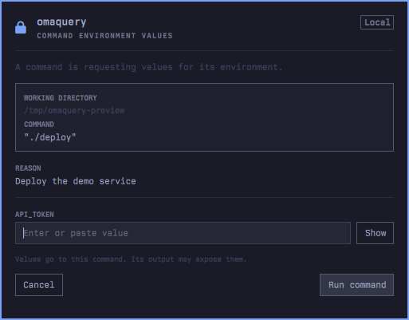

# omaquery

`omaquery` asks for values in an Omarchy desktop popup and passes them to a
command as environment variables. Prompts can appear on the local machine or on
another Omarchy machine over SSH.



Prompting requires Omarchy (`ID=omarchy` in `/etc/os-release`) and Quickshell.
Help and version still work elsewhere.

## Requirements

- Omarchy with Quickshell
- Go 1.24+ to install or build the CLI
- SSH key access and an unlocked Omarchy desktop for remote prompts

## Install

Install the CLI:

```sh
omarchy pkg add go
go install github.com/peterszarvas94/omaquery/cmd/omaquery@latest
```

Then install or update the prompt plugin:

```sh
omaquery install
```

`omaquery install` writes the matching plugin version, validates it, enables it,
and restarts the Omarchy shell when updating an already-enabled plugin. It is
safe to rerun after a new release. Keep `~/.local/bin` on `PATH`.

The marketplace plugin install only installs the Quickshell service. The
service still needs the matching CLI; run the commands above after installing
from the marketplace. `omaquery install` creates and enables the service when
needed. If the plugin came from the plugin manager, the CLI takes over its
updates so there is only one installed version.

### Another machine

Install or update on another Omarchy machine from this one:

```sh
omaquery install --remote laptop
```

The command checks that the target is Omarchy, verifies its architecture and
version, uploads the current CLI over SSH, and updates the plugin there. Use
`--force` only when the remote has a newer version and you intentionally want to
replace it.

### From a checkout

```sh
git clone https://github.com/peterszarvas94/omaquery.git
cd omaquery
make install
```

## Remove

On each machine with the prompt installed:

```sh
omaquery uninstall
```

The command removes the plugin first, then deletes the installed binary, so a
partial failure leaves the CLI available to retry. For another machine:

```sh
ssh laptop omaquery uninstall
```

Removing the `omaquery` binary disables local and remote prompts. No secrets or
other persistent files are kept by the application.

## Usage

```sh
omaquery run API_TOKEN -- ./deploy
omaquery run --reason "Publish the release" API_TOKEN -- gh release create ...
omaquery run --remote laptop API_TOKEN -- ./deploy
```

`run` options are `--reason TEXT`, `--timeout 5m` (or seconds), and
`--remote SSH_HOST`. Options come before value names. `--prompt-on` remains as a
deprecated alias for `--remote`.

The command runs where you invoke `omaquery`, even when the popup appears on
another machine. Review the displayed command before submitting: a command can
print or transmit its environment. Escape cancels the prompt.

To try it without a real secret:

```sh
omaquery run DEMO_TOKEN -- sh -c 'printf "%s\n" "$DEMO_TOKEN"'
```

## Security

- Values are sent only to the approved command's environment. They are never
  written to logs, command arguments, ordinary stdout, or persistent files.
- The local prompt bridge uses an owned mode-0700 runtime directory and a
  mode-0600 Unix socket.
- Remote prompts use ordinary SSH with host-key checking and batch mode. The
  plugin opens no network listener and runs no privileged commands.
- Like every Omarchy plugin, the popup service runs unsandboxed inside the
  Omarchy shell. The service only starts `omaquery serve` and exchanges prompt
  data with the CLI.
- A command can print or transmit its own environment. This tool keeps values
  out of the agent's direct input; it cannot constrain what the approved command
  does with them.

## License

MIT. See [LICENSE](LICENSE). Development notes are in [AGENTS.md](AGENTS.md).
